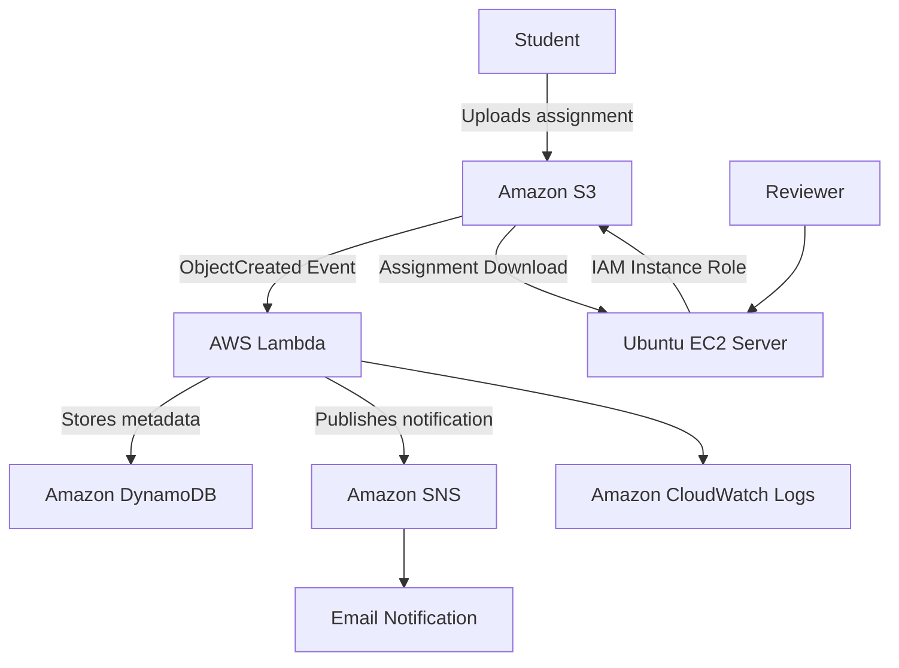

# AWS Assignment Submission & Automated Processing System

An event-driven AWS cloud project that automates student assignment submissions, metadata storage, email notifications, and reviewer access.

## Project Overview

This project provides a secure and automated way for students to submit assignment files using Amazon S3. When a student uploads a file, an AWS Lambda function is triggered automatically to process the submission, store its metadata in Amazon DynamoDB, and send an email notification using Amazon SNS.

An Amazon EC2 Ubuntu server provides reviewers with secure access to submitted assignments through IAM role-based authentication.

## AWS Services Used

- **Amazon S3:** Private storage for student assignment files.
- **AWS Lambda:** Automatically processes S3 upload events.
- **Amazon DynamoDB:** Stores assignment submission metadata.
- **Amazon SNS:** Sends email notifications.
- **Amazon EC2:** Provides a reviewer server running Ubuntu.
- **AWS IAM:** Manages permissions and role-based access.
- **Amazon CloudWatch:** Monitors Lambda execution through logs.

## Architecture

## Project Workflow

1. Students upload assignment files to a private S3 bucket.
2. S3 generates an ObjectCreated event.
3. AWS Lambda automatically processes the event.
4. Lambda extracts submission details from the S3 object key.
5. Submission metadata is stored in DynamoDB.
6. SNS sends an email notification.
7. Reviewers use an EC2 Ubuntu server to access and download assignments.
8. CloudWatch records Lambda execution logs.

## Security Implementation

- Enabled S3 Block Public Access.
- Configured student-specific S3 upload permissions using IAM policies.
- Restricted student uploads to designated S3 prefixes.
- Used an EC2 IAM instance role instead of storing permanent AWS credentials on the server.
- Restricted SSH access to a trusted IP address.

## Testing Performed

- Tested S3 assignment uploads.
- Verified Lambda execution following S3 uploads.
- Received SNS email notifications.
- Configured DynamoDB metadata storage.
- Verified EC2 IAM role authentication.
- Listed and downloaded assignment files from S3 using AWS CLI.
- Inspected Lambda execution logs in CloudWatch.

## Technologies

`AWS` `Amazon S3` `AWS Lambda` `DynamoDB` `SNS` `EC2` `IAM` `CloudWatch` `AWS CLI` `Ubuntu Linux`

## Future Improvements

- Develop a secure web-based student upload interface.
- Implement duplicate-event handling.
- Add file validation and size restrictions.
- Configure CloudWatch alarms and failure notifications.
- Introduce SQS and a dead-letter queue for improved reliability.

## Learning Outcomes

Through this project, I gained hands-on experience with AWS cloud services, event-driven architecture, IAM permissions, serverless computing, object storage, Linux administration, AWS CLI, and cloud monitoring.

**Project Type:** Personal Hands-on AWS Cloud Project
